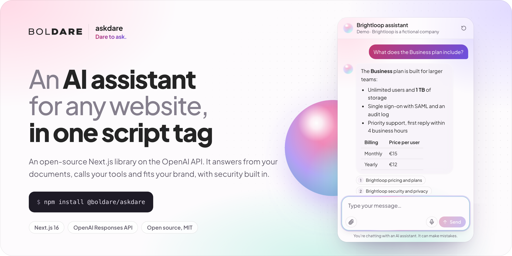
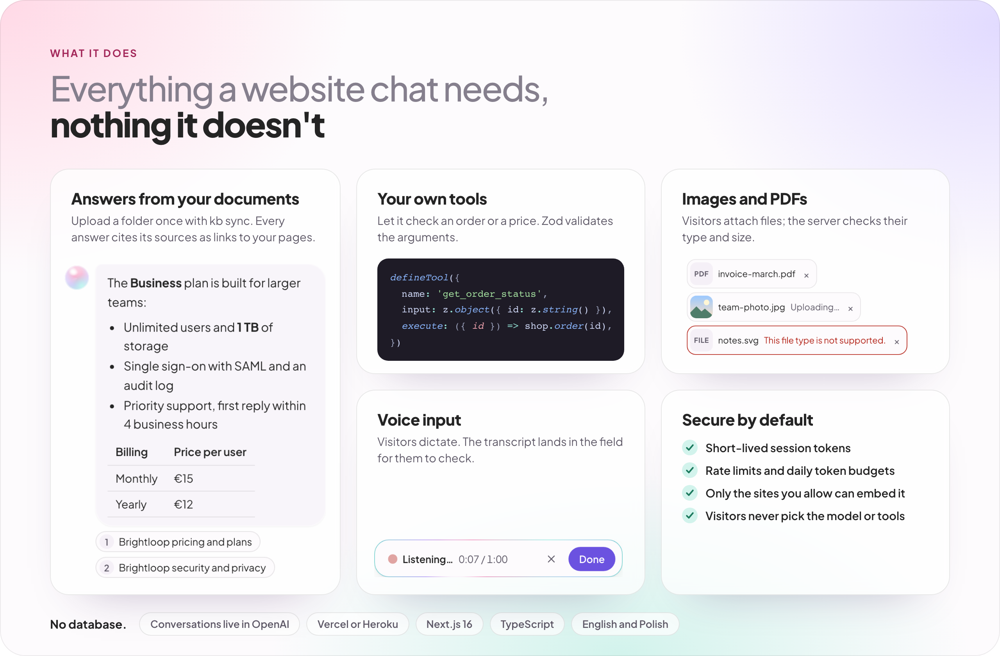
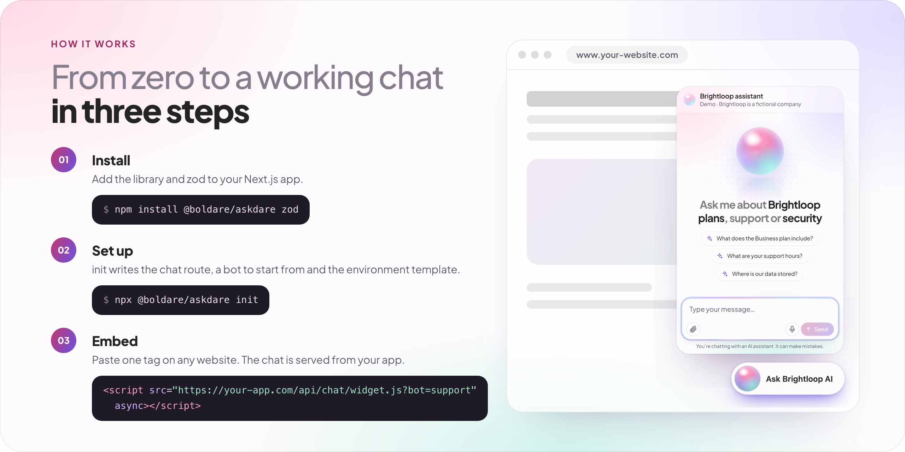
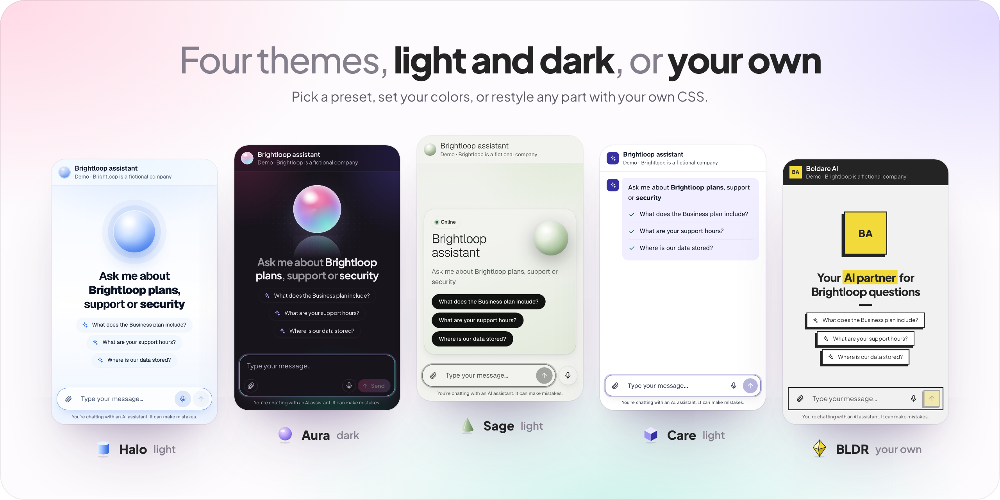

# askdare

[](https://askdare.vercel.app)

<p align="center">
  <a href="https://askdare.vercel.app"><strong>Website and live demo</strong></a> ·
  <a href="https://askdare.vercel.app/docs"><strong>Documentation</strong></a> ·
  <a href="https://www.npmjs.com/package/@boldare/askdare">npm</a> ·
  <a href="packages/askdare/CHANGELOG.md">Changelog</a>
</p>

<p align="center">
  <a href="https://github.com/boldare/askdare/actions/workflows/ci.yml"></a>
  <a href="https://www.npmjs.com/package/@boldare/askdare"></a>
  <a href="LICENSE"></a>
</p>

**Dare to ask.** `@boldare/askdare` is a Next.js library for adding an AI chatbot, built on the official OpenAI SDK, to any website. It takes one route file and one `<script>` tag, and needs no database.

> **Status: release candidate (0.1.0-rc).** The API is complete, but may still change before 0.1.0. Install the `rc` tag, and pin the exact version.

It succeeds [`@boldare/openai-assistant`](https://github.com/boldare/openai-assistant), which stopped working when OpenAI shut down the Assistants API on 2026-08-26. askdare is a new, independent project built on the Responses API.

## What it does

[](https://askdare.vercel.app/#features)

- **Embed anywhere:** a tiny loader script plus an isolated iframe, with a per-site allowlist.
- **Secure by default:** short-lived session tokens, rate limits, daily token budgets, sanitized output.
- **Knowledge base:** answers from your files via OpenAI file search, with citations linking to your pages.
- **Tools:** your own functions, defined with Zod schemas and validated end to end.
- **Attachments and images**, plus **voice input** (speech to text).
- **No database required:** conversations live in the OpenAI Conversations API.
- **Looks good out of the box:** four themes in light and dark, English and Polish texts, and everything customizable from configuration to your own CSS.

## Quick start

[](https://askdare.vercel.app/docs/getting-started)

In a Next.js 16 app with the App Router:

```bash
npm install @boldare/askdare@rc zod
npx @boldare/askdare init      # route, bot config, .env.local and the chat script
# set OPENAI_API_KEY and ASKDARE_MODEL in .env.local
npm run dev
npx @boldare/askdare doctor    # checks the key, model, permissions and headers
```

The integration is a bot definition, one route and one script tag:

```ts
// askdare.config.ts
import { defineBot } from '@boldare/askdare';

export const bots = [
  defineBot({
    id: 'support',
    model: process.env.ASKDARE_MODEL ?? '',
    instructions: 'You answer questions about our product. If you do not know, say so.',
    security: { allowedOrigins: ['https://www.example.com'] },
    widget: { theme: 'aura', greeting: 'Hi! How can I help?' },
  }),
];
```

```ts
// app/api/chat/[...path]/route.ts
import { createChatHandler } from '@boldare/askdare/next';
import { bots } from '../../../../askdare.config';

export const maxDuration = 300;
export const { GET, POST, DELETE } = createChatHandler({ bots });
```

```html
<script src="https://your-app.example.com/api/chat/widget.js?bot=support" async></script>
```

[Getting started](docs/getting-started.md) walks through it step by step.

## Themes

[](https://askdare.vercel.app/#themes)

Halo, Aura, Sage and Care come in light and dark. Set your colors in the bot's `widget` options, or restyle any part with your own CSS; BLDR is a custom theme built that way. Try each of them on the [website](https://askdare.vercel.app/#themes), and see [Themes](docs/themes.md) and [Styling](docs/styling.md).

## Documentation

The docs are on the website, at [askdare.vercel.app/docs](https://askdare.vercel.app/docs), with search and a chat that answers from them. The same pages are in [`docs/`](docs/):

- [Getting started](docs/getting-started.md), then the [configuration reference](docs/configuration.md), [embedding](docs/embedding.md), the [CLI](docs/cli.md) and [troubleshooting](docs/troubleshooting.md)
- [Knowledge base](docs/knowledge-base.md), [Tools](docs/tools.md), [Attachments](docs/attachments.md), [Voice input](docs/voice-input.md)
- [Styling](docs/styling.md) and [Themes](docs/themes.md)
- [Deployment](docs/deployment.md) to Vercel and Heroku, and the [going-public checklist](docs/going-public.md)
- [Costs](docs/costs.md), [privacy](docs/privacy.md) and [support](docs/support.md): versions, browsers and download sizes
- Coming from `@boldare/openai-assistant`? See [migrating](docs/migrating-from-openai-assistant.md).
- [Threat model](THREAT_MODEL.md) and [streaming protocol](docs/protocol.md)

For AI coding agents: [`llms.txt`](llms.txt), and the [`askdare` skill](skills/askdare/SKILL.md). Both ship in the package with the docs, so they match the installed version. To use the skill with Claude Code, copy it into your project:

```bash
mkdir -p .claude/skills && cp -R node_modules/@boldare/askdare/skills/askdare .claude/skills/
```

## Packages

| Package | What it is |
| --- | --- |
| [`@boldare/askdare`](packages/askdare) | The library: bot definitions, the chat route, the embeddable chat and the CLI |
| [`@boldare/askdare-upstash`](packages/askdare-upstash) | Rate limits and budgets shared by every server instance, in Upstash Redis |

## Design decisions

The architecture is documented as [Architecture Decision Records](docs/adr/README.md).

## Contributing

See [CONTRIBUTING.md](CONTRIBUTING.md). Report security issues privately as described in [SECURITY.md](SECURITY.md).

## License

[MIT](LICENSE) © Boldare
