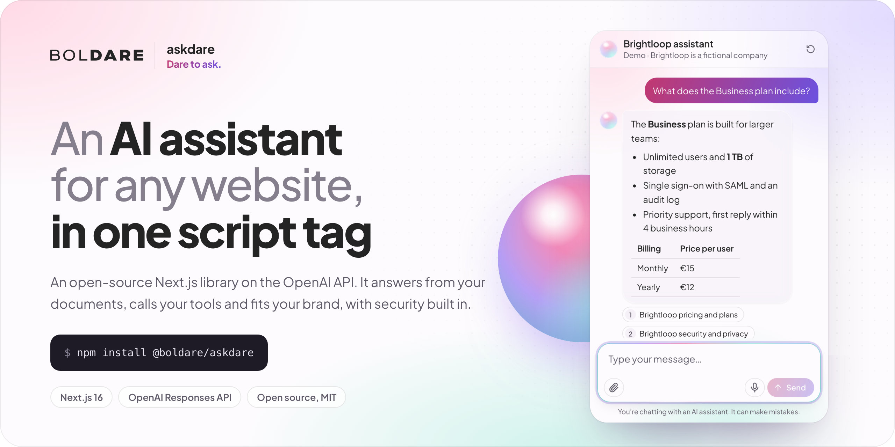
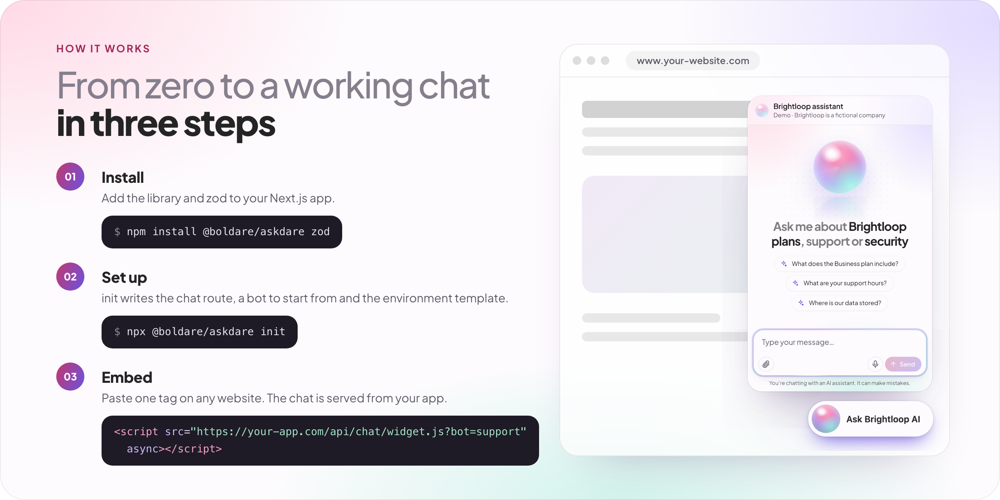
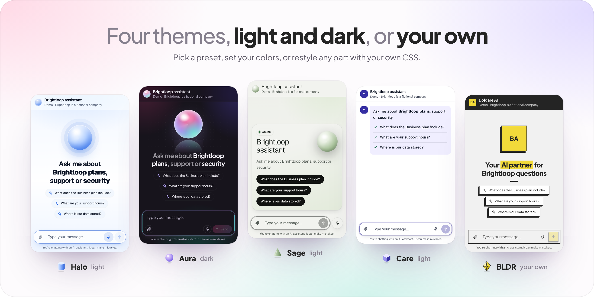

[](https://askdare.vercel.app)

<p align="center">
  An AI chatbot for any website, served by your Next.js app on the official OpenAI SDK.<br>
  One route, one script tag, no database.
</p>

<p align="center">
  <a href="https://askdare.vercel.app"><strong>Live demo</strong></a> ·
  <a href="https://askdare.vercel.app/deploy"><strong>Deploy in 5 minutes</strong></a> ·
  <a href="https://askdare.vercel.app/docs"><strong>Documentation</strong></a> ·
  <a href="https://www.npmjs.com/package/@boldare/askdare">npm</a> ·
  <a href="packages/askdare/CHANGELOG.md">Changelog</a>
</p>

<p align="center">
  <a href="https://github.com/boldare/askdare/actions/workflows/ci.yml"></a>
  <a href="https://www.npmjs.com/package/@boldare/askdare"></a>
  <a href="LICENSE"></a>
</p>

## Your chatbot in five minutes

No Next.js app yet? Deploy the [starter](examples/starter) to Vercel in one click: your own repository, your OpenAI key, no database and no code to write. [askdare.vercel.app/deploy](https://askdare.vercel.app/deploy) walks you through it and makes the `CHAT_SECRET` for you. [Heroku and the details](docs/deployment.md#one-click-deploy).

[](https://vercel.com/new/clone?repository-url=https%3A%2F%2Fgithub.com%2Fboldare%2Faskdare%2Ftree%2Fmain%2Fexamples%2Fstarter&project-name=askdare-chat&repository-name=askdare-chat&env=OPENAI_API_KEY%2CCHAT_SECRET%2CASKDARE_MODEL%2CASKDARE_INSTRUCTIONS%2CASKDARE_GREETING&envDefaults=%7B%22ASKDARE_MODEL%22%3A%22gpt-6.1-terra%22%2C%22ASKDARE_INSTRUCTIONS%22%3A%22You%20are%20the%20assistant%20on%20our%20website.%20Answer%20briefly%20and%20politely.%20If%20you%20do%20not%20know%20something%2C%20say%20so.%22%2C%22ASKDARE_GREETING%22%3A%22Hi%21%20How%20can%20I%20help%3F%22%7D&envDescription=OPENAI_API_KEY%3A%20a%20key%20from%20a%20dedicated%20OpenAI%20project%20with%20a%20hard%20spend%20limit.%20CHAT_SECRET%3A%20at%20least%2032%20random%20characters%3B%20askdare.vercel.app%2Fdeploy%20makes%20one%20for%20you.%20ASKDARE_MODEL%3A%20a%20current%20OpenAI%20model%20your%20project%20may%20use.%20ASKDARE_INSTRUCTIONS%3A%20what%20the%20bot%20does%20and%20how%20it%20answers.%20ASKDARE_GREETING%3A%20the%20first%20message%20in%20the%20chat.&envLink=https%3A%2F%2Faskdare.vercel.app%2Fdeploy)

## Three steps

[](https://askdare.vercel.app/docs/getting-started)

In a Next.js 16 app:

```bash
npm install @boldare/askdare zod
npx @boldare/askdare init
```

`init` writes the chat route, a bot to start from and `.env.local`, and adds the chat to your layout. Put your OpenAI key and model in `.env.local`, run the app, and the chat is there. The bot is a few lines you own:

```ts
// askdare.config.ts
import { defineBot } from '@boldare/askdare';

export const bots = [
  defineBot({
    id: 'support',
    model: process.env.ASKDARE_MODEL ?? '',
    instructions: 'You answer questions about our product. If you do not know, say so.',
    security: { allowedOrigins: ['https://www.example.com'] },
    widget: { theme: 'aura', greeting: 'Hi! How can I help?' },
  }),
];
```

**[Getting started](docs/getting-started.md)** takes you from an empty app to a working chat in about 15 minutes.

Or [try it first, in five minutes](#your-chatbot-in-five-minutes), without your own app.

## What you get

[](https://askdare.vercel.app/#features)

[Knowledge base](docs/knowledge-base.md) · [Tools](docs/tools.md) · [Reply options](docs/reply-options.md) · [Attachments](docs/attachments.md) · [Voice input](docs/voice-input.md) · [The chat inside your page (React)](docs/react.md) · [Answer ratings](docs/feedback.md) · [Observability](docs/observability.md) · [Chat events](docs/events.md) · [Security](THREAT_MODEL.md)

## Themes

[](https://askdare.vercel.app/#themes)

Pick a theme, set your brand's colors, or restyle any part with your own CSS, the way BLDR does. Switch between them on the [website](https://askdare.vercel.app/#themes), then read [Themes](docs/themes.md) and [Styling](docs/styling.md).

## Documentation

The guides are on [askdare.vercel.app/docs](https://askdare.vercel.app/docs), with search and a chat that answers from them. The same pages are in [`docs/`](docs/), and they ship in the package, so they match the version you installed.

- **Start:** [Getting started](docs/getting-started.md) · [Embedding the chat](docs/embedding.md) · [Command line](docs/cli.md)
- **Features:** [Knowledge base](docs/knowledge-base.md) · [Tools](docs/tools.md) · [Reply options](docs/reply-options.md) · [Attachments](docs/attachments.md) · [Voice input](docs/voice-input.md) · [Signed-in visitors](docs/identity.md)
- **Look and language:** [Themes](docs/themes.md) · [Styling](docs/styling.md) · [Texts](docs/texts.md) · [The chat inside your page (React)](docs/react.md)
- **Going live:** [Deployment](docs/deployment.md) · [Going-public checklist](docs/going-public.md) · [Costs](docs/costs.md) · [Observability](docs/observability.md) · [Chat events](docs/events.md) · [Answer ratings](docs/feedback.md) · [Privacy](docs/privacy.md)
- **Reference:** [Configuration](docs/configuration.md) · [Troubleshooting](docs/troubleshooting.md) · [Support matrix](docs/support.md) · [Wire protocol](docs/protocol.md) · [Custom rate-limit store](docs/custom-store.md)
- **Under the hood:** [Threat model](THREAT_MODEL.md) · [Design decisions](docs/adr/README.md)
- **AI coding agents:** [`llms.txt`](llms.txt) and the [`askdare` skill](skills/askdare/SKILL.md), both in the package ([how to use them](docs/getting-started.md#working-with-an-ai-coding-agent))

Coming from `@boldare/openai-assistant`? It stopped working when OpenAI shut down the Assistants API, and askdare is its successor: see [Migrating](docs/migrating-from-openai-assistant.md).

## Packages

| Package | What it is |
| --- | --- |
| [`@boldare/askdare`](packages/askdare) | The library: bots, the chat route, the embeddable chat and the CLI |
| [`@boldare/askdare-upstash`](packages/askdare-upstash) | Rate limits and budgets shared by every server instance, in Upstash Redis |
| [`@boldare/askdare-otel`](packages/askdare-otel) | OpenTelemetry spans for every chat turn, following the GenAI conventions |

---

[Contributing](CONTRIBUTING.md) · [Security policy](SECURITY.md) · [MIT license](LICENSE) · Made by [Boldare](https://www.boldare.com)
