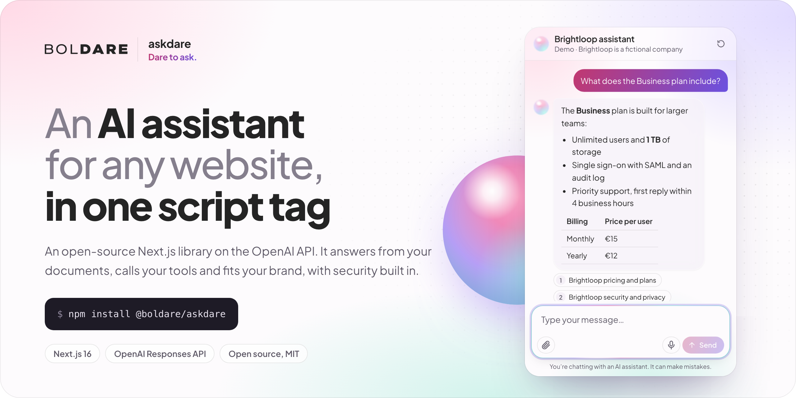
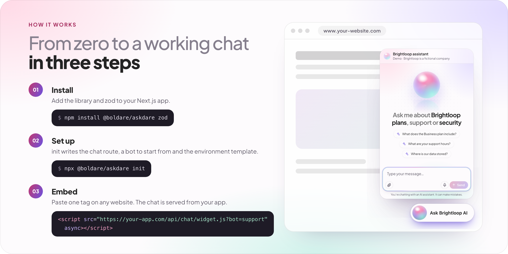
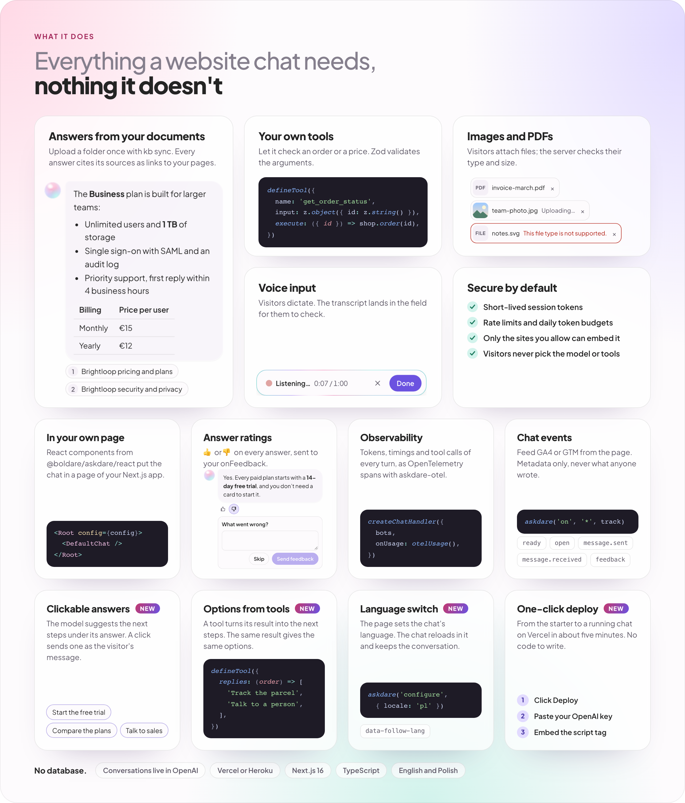
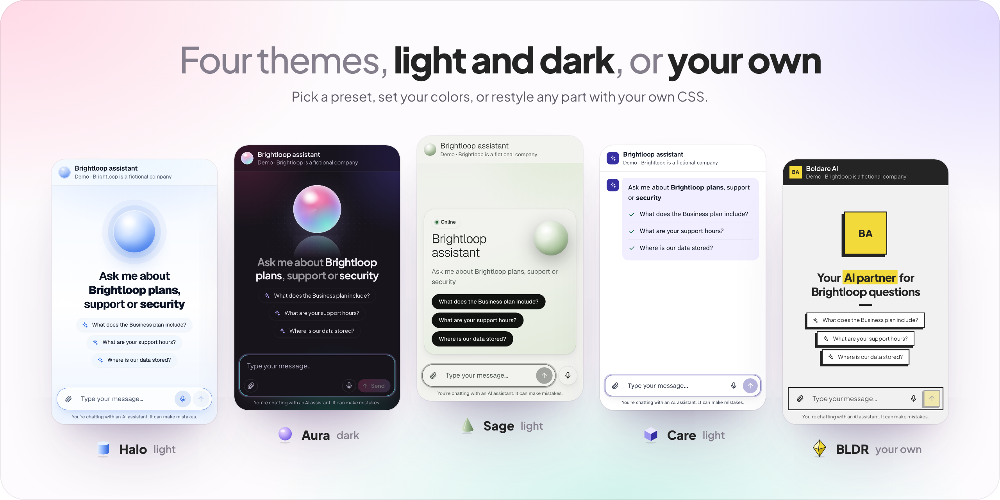

# @boldare/askdare

[](https://askdare.vercel.app)

**Dare to ask.** An AI chatbot for any website, served by your Next.js app on the official OpenAI SDK. One route, one script tag, no database.

**[Live demo](https://askdare.vercel.app)** · **[Documentation](https://askdare.vercel.app/docs)** · [GitHub](https://github.com/boldare/askdare) · [Changelog](https://github.com/boldare/askdare/blob/main/packages/askdare/CHANGELOG.md)

## Three steps

[](https://askdare.vercel.app/docs/getting-started)

In a Next.js 16 app:

```bash
npm install @boldare/askdare zod
npx @boldare/askdare init
```

`init` writes the chat route, a bot to start from and `.env.local`, and adds the chat to your layout. Put your OpenAI key and model in `.env.local`, run the app, and the chat is there. The bot is a few lines you own:

```ts
// askdare.config.ts
import { defineBot } from '@boldare/askdare';

export const bots = [
  defineBot({
    id: 'support',
    model: process.env.ASKDARE_MODEL ?? '',
    instructions: 'You answer questions about our product. If you do not know, say so.',
    security: { allowedOrigins: ['https://www.example.com'] },
    widget: { theme: 'aura', greeting: 'Hi! How can I help?' },
  }),
];
```

**[Getting started](https://askdare.vercel.app/docs/getting-started)** takes you from an empty app to a working chat in about 15 minutes.

## What you get

[](https://askdare.vercel.app/#features)

[Knowledge base](https://askdare.vercel.app/docs/knowledge-base) · [Tools](https://askdare.vercel.app/docs/tools) · [Attachments](https://askdare.vercel.app/docs/attachments) · [Voice input](https://askdare.vercel.app/docs/voice-input) · [The chat inside your page (React)](https://askdare.vercel.app/docs/react) · [Answer ratings](https://askdare.vercel.app/docs/feedback) · [Security](https://github.com/boldare/askdare/blob/main/THREAT_MODEL.md)

## Themes

[](https://askdare.vercel.app/#themes)

Pick a theme, set your brand's colors, or restyle any part with your own CSS, the way BLDR does. Switch between them on the [website](https://askdare.vercel.app/#themes), then read [Themes](https://askdare.vercel.app/docs/themes) and [Styling](https://askdare.vercel.app/docs/styling).

## Documentation

The guides are on [askdare.vercel.app/docs](https://askdare.vercel.app/docs), with search. They also ship in this package, in `node_modules/@boldare/askdare/docs/`, so they match the version you installed.

- **Start:** [Getting started](https://askdare.vercel.app/docs/getting-started) · [Embedding the chat](https://askdare.vercel.app/docs/embedding) · [Command line](https://askdare.vercel.app/docs/cli)
- **Look and language:** [Themes](https://askdare.vercel.app/docs/themes) · [Styling](https://askdare.vercel.app/docs/styling) · [Texts](https://askdare.vercel.app/docs/texts) · [The chat inside your page (React)](https://askdare.vercel.app/docs/react)
- **Going live:** [Deployment](https://askdare.vercel.app/docs/deployment) · [Going-public checklist](https://askdare.vercel.app/docs/going-public) · [Costs](https://askdare.vercel.app/docs/costs) · [Observability](https://askdare.vercel.app/docs/observability) · [Chat events](https://askdare.vercel.app/docs/events) · [Answer ratings](https://askdare.vercel.app/docs/feedback) · [Privacy](https://askdare.vercel.app/docs/privacy)
- **Reference:** [Configuration](https://askdare.vercel.app/docs/configuration) · [Troubleshooting](https://askdare.vercel.app/docs/troubleshooting) · [Support matrix](https://askdare.vercel.app/docs/support)
- **AI coding agents:** `llms.txt` and the `askdare` skill ship in the package ([how to use them](https://askdare.vercel.app/docs/getting-started#working-with-an-ai-coding-agent))

## Add-ons

| Package | What it adds |
| --- | --- |
| [`@boldare/askdare-upstash`](https://www.npmjs.com/package/@boldare/askdare-upstash) | Rate limits and budgets shared by every server instance, in Upstash Redis |
| [`@boldare/askdare-otel`](https://www.npmjs.com/package/@boldare/askdare-otel) | OpenTelemetry spans for every chat turn, following the GenAI conventions |

## Requirements

Node.js 22 or later, Next.js 16 with the App Router on the Node.js runtime, React 19 and zod 4.1 or later.

## License

MIT © [Boldare](https://www.boldare.com)
